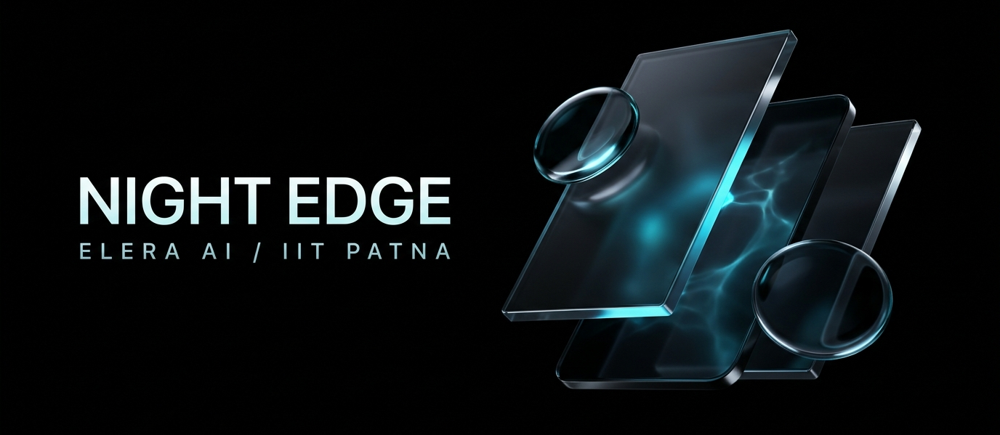
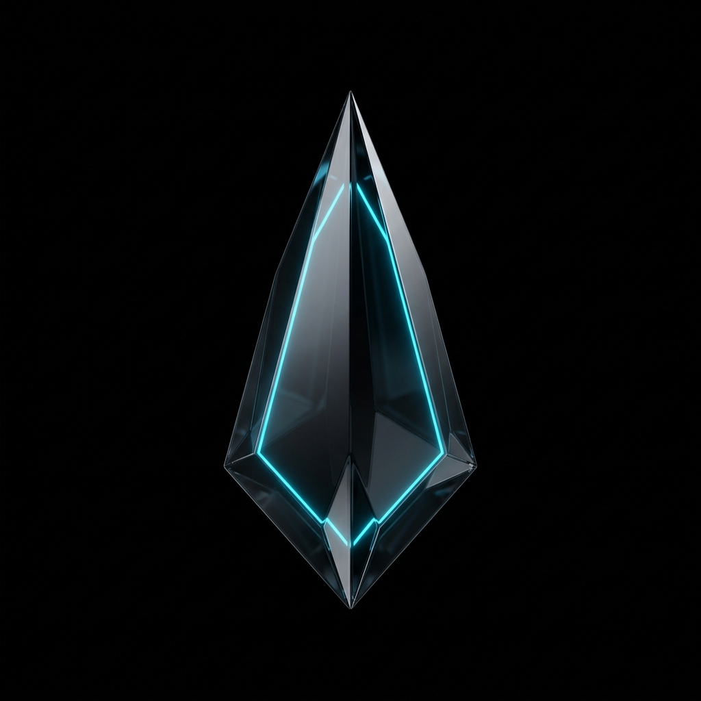
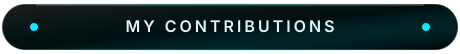
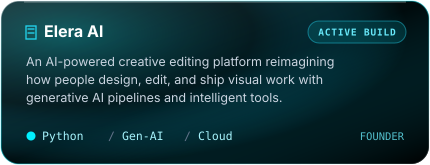

<!-- Banner -->

  <a href="https://github.com/NightAI707">
    &nbsp;
  </a>
  <a href="https://github.com/NightAI707/NightAI707">
    &nbsp;
  </a>
  

 

<!-- Who Am I? -->

**Who Am I?**

I am **Night Edge**, a student at `IIT Patna` and an independent builder working on **AI**, software engineering, and emerging tech. Right now I am building **Elera AI**, an AI-powered creative editing platform, and spending most of my time shipping products rather than just talking about them.

Before Elera, I built **AI tools**, **Roblox experiences**, and **research prototypes** across `Python`, `JavaScript`, `TypeScript`, and `Lua`. I care about software that feels sharp, fast, and intentional, where clean engineering meets visual design.

Outside my main builds, I dig into **generative AI**, **intelligent systems**, **cybersecurity**, and **open-source software**, always picking up whatever new stack or paper helps me build the next thing better.

 
 

<!-- Social Badges -->

  <strong>You can Click here</strong>
   

  
  
  

 

> [!Caution]
>
> Code is never finished, it only gets **better**.
>
> What you see here is built with **practice**, **curiosity**, and **persistence**.

 

<!-- My Contributions Title -->

  
   
   

 

<table align="center">
  <tr>
    <!-- Skills Left -->
    <td valign="top" width="45%">
      
       
       
       
       
       
    </td>
    <!-- Project + Streak Right -->
    <td valign="top" width="55%">
      
       
      
    </td>
  </tr>
</table>
