  

<h1 align="center">Night Edge</h1>

<h3 align="center">AI Engineer &amp; Builder</h3>

  

  Building AI-powered creative tools and intelligent systems with clean engineering.

 

  

**Night**, here. Student at **IIT Patna** and independent builder focused on AI engineering and software.

I'm currently building **Elera AI**, an AI-powered creative editing platform, while exploring generative AI, intelligent systems, and AI-native computing.

Previously, I've built **AI products, Roblox experiences, and research projects** across **Python, JavaScript, TypeScript, and Lua**, alongside exploring open-source development and cybersecurity.

My goal is simple: write clean code, ship real AI products, and build systems that last.

 

  

  
  &nbsp;&nbsp;&nbsp;
  
  &nbsp;&nbsp;&nbsp;
  

 

  

  

  
  &nbsp;&nbsp;
  
  &nbsp;&nbsp;
  
  &nbsp;&nbsp;
  
  &nbsp;&nbsp;
  
  &nbsp;&nbsp;
  
  &nbsp;&nbsp;
  

 

  

  

 

  

  

 

  

<picture>
  <source media="(prefers-color-scheme: dark)"
    srcset="https://raw.githubusercontent.com/NightAI707/NightAI707/output/pacman-contribution-graph-dark.svg">
  <source media="(prefers-color-scheme: light)"
    srcset="https://raw.githubusercontent.com/NightAI707/NightAI707/output/pacman-contribution-graph.svg">
  

    
  

</picture>

 

  

  

