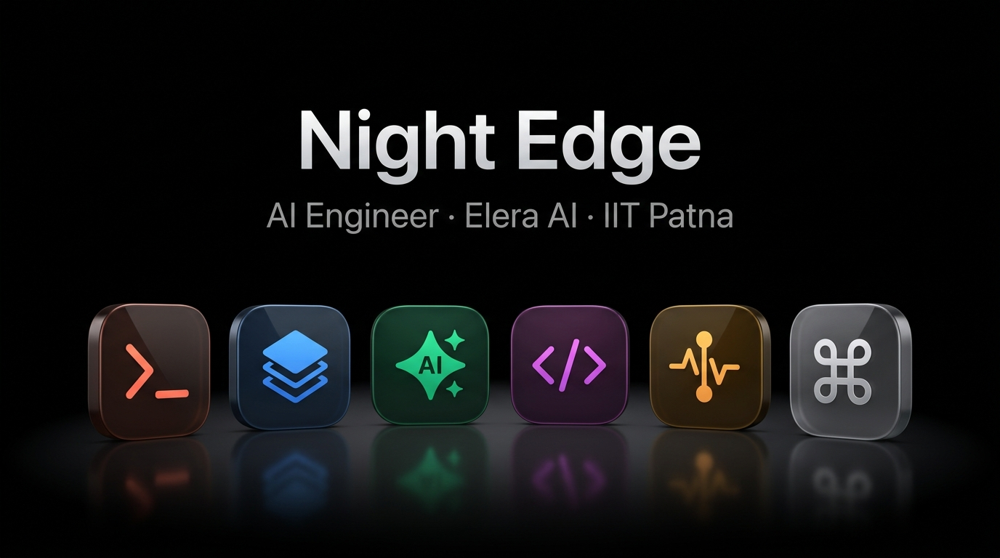
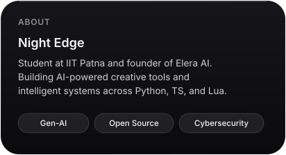
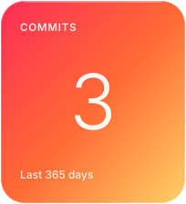
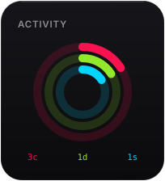
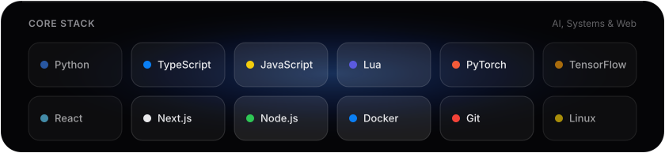

<table width="100%">
  <tr>
    <td width="49%" valign="top">
      
    </td>
    <td width="25.5%" valign="top">
      
    </td>
    <td width="25.5%" valign="top">
      
    </td>
  </tr>
</table>

<table width="100%">
  <tr>
    <td width="33.3%" align="center">
      
    </td>
    <td width="33.3%" align="center">
      
    </td>
    <td width="33.3%" align="center">
      
    </td>
  </tr>
</table>

